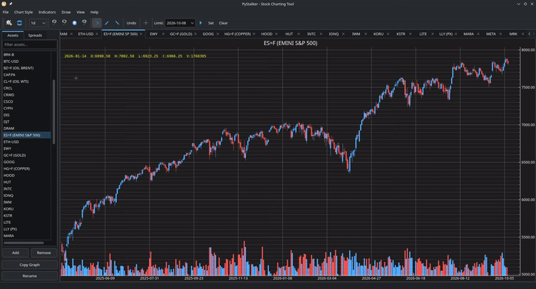

# pystalker
A trading analysis software, it is a port of the old and discontinued Qtstalker.


# Description of the project

Around 2005/2006 a trading analisys program was bundled with Debian Linux distributions, this was the time I discovered Qtstalker.

The program was very good and very advanced to its time, took a very good advantage of the LibQT3 and TA libraries and it can work with lots of external resources such Yahoo API, CSV data, CME data and NYBot data.

Around 2010 there was the begin of a new version that changed all the behaviour of the program, but never was released, I personally talked with the main developer Stefan Stratigakos about this new version, but some time later I discovered that the program was discontinued and the project abandoned.

I worked almost every day with qtstalker, I built some infrastructure of data ingestion in real time to feed qtstalker every minute and worked with trading graphics in almost real time, I reverse-engineered my own broker to get real-time data from futures, CFDs, commodities and Forex, my infrastructure is still alive and I made it fail-safe against every possible problem with receiving data, from a electric cut to a connection loss, my system is always feeding Qtstalker with data as far as possible.
 
I had a real time trading system made with my own hands shared with free open source software and I was very proud of it, at that time platforms like Trading View and many others famous platforms as well didn't exist.

This project is done with a wish of recover that project and make it open source software because I search for a new similar project and didn't find anything that can compare with Qtstalker and I want to make some improvements I had in mind at the time I was using Qtstalker.

I only have a very basic knowledge of C++ and LibQT, I am mainly a python developer, so with AI and agentic development I tried to recover this project with some stages:

1.- I tried to compile Qtstalker inside a very old Debian distribution in docker, get the binary in my current and modern Ubuntu system, and copied all the old LibQT3 libraries in my system, good but not satisfactory at all.
2.- I tried to port the original Qtstalker program from LibQT3 to LibQT5 using OpenCode, Ollama and GLM-5 model, got some good results but not satisfactory at all.
3.- Then I tried to program a C++ LibQT5/6 port from scratch telling AI to make the same program as the qtstalker original code, still not satisfactory.
4.- My final try was to make a python program with PyQT6 to emulate the same behaviour of the original program, and providing the AI agent with the original code, it seems that this time the result was good.

When I wrote this README first time, the project is still in a very early stage, has lots of bugs, many functions are not working and there is a long trip to get the program finished and in the stage of what I would consider finished, but I want to share the code with the communinty and see if there are people interested on the project and able to contribute to it, in the current state it is really usable and can deliver results.

Now the project is a MVP, can get daily data and I added some new improvements like spreads, ML indicators for prediction and the automatic channel detection.


# Features

- Downaloads data from Yahoo Finance (only daily data), from the Phemex exchange (crypto spot and perp futures, tokenized stocks/ETFs and TradFi perp futures, only daily data), from the Pionex exchange (crypto spot pairs and perpetual futures, with deep history) and imports CSV files, future support for possibly other data source endpoints, also in real time!
- Overlay technical indicators: Simple Moving Average, Exponential Moving Average, Bollinguer Bands, Parabollic SAR.
- Stacked technical indicators: MACD, RSI, CCI, ADX, ATR, Momentum, ROC, Stochastic, Stochastic RSI, WILLR, OBV, MFI.
- Drawings: Trendlines, Horizontal lines, Vertical lines, Ascending and Descending Channels (drawn manually or detected automatically), future support for fibonacci drawings.
- Types of graphs: Lines, candles, Heikin Ashi, future support for open candles.
- Tools: pystalker_cli.py, the unified command-line program - one program, one command per tool: `operations` (the trading journal), `update` (update all assets' data, the File > Update All Stock Data twin), `scanner` (the fused scanner: `--channels` for the drawn channels, `--supertrend` for the supertrend indicator, `--all` or bare for both at once) and `list phemex` / `list pionex` (the exchange product listings). Every command keeps the flags of its original program; the standalone versions live in console_programs/.
- Volatility prediction (console_programs/volatility_prediction.py): a standalone machine-learning experiment, independent of the rest of the project for now. It reads the database and predicts, per asset, the next day's percent volatility and the probability of a high-volatility day (above the asset's own median) with a pluggable ML algorithm (LightGBM by default, `--model sklearn` to swap). Default mode predicts the day after the last bar of every asset and records each prediction in the `volatility_predictions` journal, so its result - the signed weekly percentage of its predicted day's Friday-close week - can be checked over the following week: the prediction table shows a VERIFIED / AVG WEEK % summary per asset, `--results` shows the journal against its outcomes (per-prediction with `--asset`, per-asset averages otherwise), and `--weekly` lists the weekly percentage of all the assets for all their history (`--no-store` skips recording; `--final-date` runs the split-at-date historical backtest). `--half-life YEARS` applies a recency weighting to the training (each day's weight halves every YEARS of age over the full history; default 0 = uniform weights, which measured slightly better on both out-of-sample windows tried). The listing's last fields read the stored history, all computed by the batch companion `volatility_accuracy.py`: **MATCH %** is the predictor's historical weekly accuracy per asset (it walks every week of the stored history, makes the prediction as of each week's end with only the data known by then - yearly walk-forward retraining - and counts the weeks whose high/low call matched the real outcome; the week-by-week rows are stored and browsable with `--weeks`), and **AVG DAY %** / **DAY MATCH %** are the daily mirror (`--daily` walks every day, storing one row per day - browsable with `--days` - and the average realized daily volatility plus the day-call accuracy per asset). The listings show the assets' personalized display names; `--asset` accepts the official symbol, the display name, or an unambiguous part of either.
- Trading journal: Operations (Trading -> Operations) to annotate and list trading operations (bots, spots/futures, paper trading, planned projects that may or may not start) with their volume, current price, the net gain % (the 1x move, without leverage), the leveraged gain % and the final gain % (the leveraged gain at the exit price); the list is grouped in three tabs - Open (running, not planned), Planned (all the planned projects) and Closed (done, not planned), with the counts on the tabs; planned operations keep the plain gain look (no green/red) until they really start; each operation draws its entry line (bright green for longs, bright red for shorts) and its exit line (bright blue) on the asset's chart. The same journal is listed from the terminal with `python pystalker_cli.py operations` - the same columns and numbers, split into the same three titled sections (or one alone with `--open`/`--planned`/`--closed`), ANSI green/red colors (planned operations stay plain) and filters (`--asset`, `--paper`).
- Assets have an official ticker for the data provider and a personalized display name (lower case allowed) shown in the ticker list, chart tabs, Operations and the spread creator's asset pickers, so renamed assets keep updating from the right source.


# Automatic channel detection

The automatic channel is one of the improvements I had in mind since my Qtstalker times: with one click (Draw -> Automatic Channel) the program analyses the last year of the asset and draws an ascending or descending channel over the trend, with a quality close to what you would get by drawing it by hand.


How it works:

- It analyses the last 12 complete months of data, excluding the current (partial) month.
- The channel always tries to **start on the window's absolute minimum (ascending channel) or maximum (descending channel)** - the year's lowest low / highest high anchor the base line first, tried on both the standard window and the one including the current month (when the current rally has broken the standard-window extreme channel, the extended one - which contains the newest prices - is the one drawn); only when no valid channel can be built from them does it fall back to the year-start swing and then to the other confirmed swing points.
- A channel is only valid when its lines are respected **from its anchor on** - the lines are drawn from the anchor bar to the right, so that is exactly the range it must contain: the base line may be touched by later lows but never pierced (pokes up to 1% of the year's price range count as touches), and the parallel line goes through the year's extreme from the anchor, so nothing crosses it. The supports are tried in cleanliness order until one produces a valid channel.
- The channel is only drawn if the current price respects it: if any recent close has gone beyond one of the channel lines the candidate is invalidated and the program recalculates with the next candidate before drawing anything. For very strong trends where every candidate is broken it retries once including the current month, so the channel contains the newest prices.
- When the last year admits no clean channel at all (e.g. an accelerating trend piercing every base line), the **best-effort channel** - the first candidate in priority order whose base line is pierced by at most 15% of the year's price range and that the current price has not broken - is drawn as a last resort: the closest to what you would draw by hand when some wicks must stay outside. Only when even that is impossible (nothing is drawn).
- Once drawn, the result is a normal channel drawing: it is never recalculated or moved again, and you can edit it, copy it, recolor it or delete it exactly like any manually drawn channel.

To be honest, the detection is not perfect, but it is near perfect: markets are messy and occasionally it can miss a structure that your trader eye will see better. For those cases you can always draw the channel manually, the automatic channel is only one more tool in the toolbox.



Full quality video: [automatic_channel.mp4](automatic_channel.mp4)

<!-- Note: GitHub does not render <video> players for files committed in the
     repository. If you prefer a real video player instead of the animated GIF:
     open this file in the GitHub web editor and drag & drop automatic_channel.mp4
     at this spot - GitHub will upload it and insert a working inline player. -->


# Discovering assets near the channel limits

The channels become much more useful when you can watch them all at once. The channel scanner (the fused `python pystalker_cli.py scanner --channels`) is an independent tool that scans every asset in the pystalker database, discards the ones without drawn channels, and reports which assets have their price near a channel line - by default inside the channel and within 10% of the lower or upper line - showing the asset (its personalized display name, like Operations, falling back to the official symbol when it has none), whether the channel is ascending or descending, which line the price is near, and the proximity percentage. It also notifies you when the current price has broken a channel, so you know that channel is invalidated and you can draw a new one. The CHANNEL column shows Ascending in green and Descending in red letters, and the NEAR LINE column shows Upper in green and Lower in red; the broken-channels notifications use the same color coding (Ascending channel in green, Descending channel in red, "beyond the upper line" in green, "beyond the lower line" in red). `--no-color` prints plain text, and with `--lower-than <price>` the whole report keeps only the assets whose last price is at that price or lower (e.g. `--lower-than 15`); the application's Channel Scanner dialog (Trading > Channel Scanner) has the same filter as its "Lower than" input box, and its CHANNEL / NEAR LINE columns and the "beyond upper/lower line" sentences use the same color coding as backgrounds (white letters on green/red, the Operations-list look); the two sections are separated by a draggable border (the near table keeps about 3x the broken section's height), double-clicking a row opens the asset's chart with draggable indicator lines at the channel's line values (upper in green, lower in red), and clicking a column header sorts the tables like the Operations list (the numeric columns sort numerically).

```
python pystalker_cli.py scanner --channels
python pystalker_cli.py scanner --channels --max-proximity 5
python pystalker_cli.py scanner --channels --asset BTC-USD
python pystalker_cli.py scanner --channels --lower-than 15    # only assets at $15 or lower
```

The Supertrend scanner (the fused `python pystalker_cli.py scanner --supertrend`) is its sibling: it computes the classic Supertrend indicator (ATR period 10, multiplier 1.8 - changeable with `--period` and `--multiplier`) over each asset's daily bars and reports the last close against the ACTIVE trend line - the lower support in an Up trend, the upper resistance in a Down trend. The TOUCHING table lists the assets whose close is within (by default) 10% of the line, with the trend (Up in green, Down in red), the line, the trend age in bars, the proximity and the values; the SURPASSED notifications report the assets whose close crossed the line on the last bar - in the classic Supertrend the trend flips exactly then ("the Down trend flipped Up - the close X surpassed the upper line (Y) by Z%", green for the upper line, red for the lower one). The application's Supertrend dialog (Trading > Supertrend) mirrors the channel scanner's look: the same color coding as backgrounds (white letters on green/red), the period/multiplier/max-proximity controls, a draggable border between the sections (the touching table keeps about 3x the surpassed section's height), column sorting like the Operations list, and double-clicking a row opens the asset's chart with a draggable indicator line at the reported level colored BY THE TREND (green in an Up trend, red in a Down one - the trend is the supertrend's signal); the next double-click replaces the previous line.

Both scans live in ONE command too: the `scanner` command of pystalker_cli.py fuses them - `--channels` for the channel scan alone, `--supertrend` for the supertrend scan alone, and `--all` (or a bare `scanner`) for both reports one after the other, with `--max-proximity` and `--asset` applying to both and the scan-specific flags keeping their meanings. After the two reports, the `--all` mode appends the both-scans-by-asset view: one row per asset with its channel condition and its supertrend condition side by side ('-' when the asset has only one of them), sorted by the assets' display names, in two tables - NEAR A CHANNEL LINE / TOUCHING THE SUPERTREND LINE (with the trend age and the last close) and BROKEN CHANNEL / SUPERTREND FLIP - each closed by the count of assets with both conditions, only the channel's and only the supertrend's, so it is easy to see which assets have both conditions and which only one; an asset with several channel drawings shows its nearest (or closest broken) one, and the same color coding as the reports is used. The standalone programs console_programs/channel_scanner.py, console_programs/supertrend.py and console_programs/scanner.py keep running on their own.

```
python pystalker_cli.py scanner                    (channels + supertrend)
python pystalker_cli.py scanner --supertrend --max-proximity 5 --asset BTC-USD
python pystalker_cli.py scanner --supertrend --period 10 --multiplier 3
python pystalker_cli.py scanner --all
```

Example output (report date and time are always printed first, trimmed here):

```
Report generated: 2026-10-11 20:35:12 CEST
Channel scanner - assets with price within 10% of a channel line
Scanned 72 asset(s) with channel drawings

ASSET                CHANNEL     NEAR LINE  PROXIMITY    LAST CLOSE    LINE VALUE
^TNX (10Y US BOND)   Ascending   Upper          0.92%          5.32          5.37
SPY                  Ascending   Lower          1.72%        778.57        765.42
AAPL                 Ascending   Upper          2.90%        336.64        346.68
QQQ                  Ascending   Lower          4.30%        751.27        720.32
BTC-USD              Ascending   Upper          7.17%      82952.51      89362.74
AMD                  Ascending   Upper          7.66%        608.10        658.55
...
```


# Data sources

Daily candles come from three download sources, and you don't have to think about which one to use:

- **Yahoo Finance** for stocks, indices, bonds, forex and the big crypto pairs.
- **Phemex** (public API, no account needed) for everything Yahoo can't serve: the USDT/USDC perp futures (BTCUSDT, ETHUSDT...), the TradFi perp futures on tokenized stocks/indices/commodities (TSLAUSDT, NAS100USDT, XAUUSDT - gold...), the spot tokenized stocks (TSLA, AAPL, NVDA... traded against USDT around the clock) and the long tail of crypto pairs.
- **Pionex** (public API, no account needed) for its spot pairs (`BTC_USDT`, including the xStocks tokenized stocks `AAPLX_USDT`, `TSLAX_USDT`, `SPYX_USDT`...) and its perpetual futures (`BTC_USDT_PERP`), with deeper history: the kline endpoint pages back up to 10,000 daily candles (BTC_USDT reaches back to 2017).

You type the symbol in the normal Download flow and the program tries Yahoo Finance first; if Yahoo has nothing for that symbol it falls back to Phemex and then to Pionex automatically, so Phemex-only symbols like `sTSLAONUSDT` or `sBTCUSDT` and Pionex-only symbols like `BTC_USDT` or `BTC_USDT_PERP` simply download. Each asset remembers which source served it, so **Update All Stock Data** keeps fetching every asset from its right source. Phemex serves up to the last 1000 daily candles (around 2.7 years), more than enough for the automatic channel (1 year) and the S-R and scanner tools.

Since the Phemex symbol names are technical (the `s` prefix is their spot convention, `sTSLAONUSDT` is TSLAON/USDT), **File -> Download Phemex Symbol...** opens a searchable list of every listed Phemex product (spot pairs, crypto perp futures and TradFi/tokenized perps - search "Tesla", "gold", "BTC"... by asset name and double-click to download).

From the console, `python pystalker_cli.py list phemex` lists the Phemex assets with the exact symbols the Download flow accepts. By default it shows the **perp futures and the tokenized assets**: the crypto perp futures (BTCUSDT, BTCUSD...), the TradFi perp futures on tokenized stocks/indices/commodities (TSLAUSDT, NAS100USDT, XAUUSDT, SPACEXUSDT, OPENAIUSDT...) and the spot tokenized assets (the Ondo tokenized stocks and ETFs: Tesla, Apple, NVIDIA, Microsoft, SPY, QQQ, gold and silver trusts..., plus the xStocks series like SpaceX):

```
python pystalker_cli.py list phemex
python pystalker_cli.py list phemex --search Tesla
python pystalker_cli.py list phemex --type tradfi     # only the tokenized asset perps
python pystalker_cli.py list phemex --type crypto      # the normal crypto spot pairs
python pystalker_cli.py list phemex --type all
```

For Pionex, `python pystalker_cli.py list pionex` lists all its products (940: the spot pairs and the perpetual futures, with a NAME column for the perpetuals) with the exact symbols the Download flow accepts:

```
python pystalker_cli.py list pionex
python pystalker_cli.py list pionex --search BTC
python pystalker_cli.py list pionex --type spot        # only the spot pairs
python pystalker_cli.py list pionex --type perp         # only the perpetual futures
python pystalker_cli.py list pionex --all               # include the disabled products
```


# Running the program

Some parts of this project are C++ (from PyQT6) to improve speed to avoid the python slowing but you don't need to compile anything, I recommend to install PyQT6 libraries (if you still don't have on your Linux system) and create a virtual environment and run the program:

```
virtualenv venv
source venv/bin/activate
pip install -r requirements.txt
./pystalker_run.py
```

Or you can simply run directly without a virtual envinronment (not recommended):

```
pip install -r requirements.txt
./pystalker_run.py
```

I hope you like and enjoy this project, I promise to extend and maintain it.


# Configuration

This program will create a directory .pystalker in your home directory and it will create a little SQLite3 database to store the program configuration and the prices database.


Regards

Juan Luis Martínez

