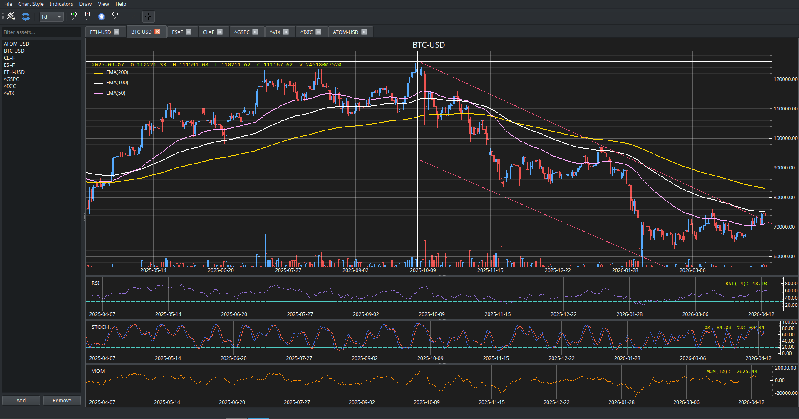
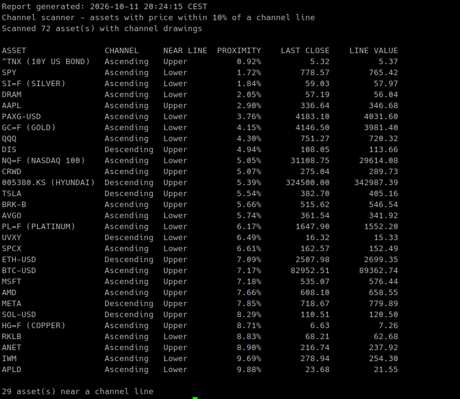
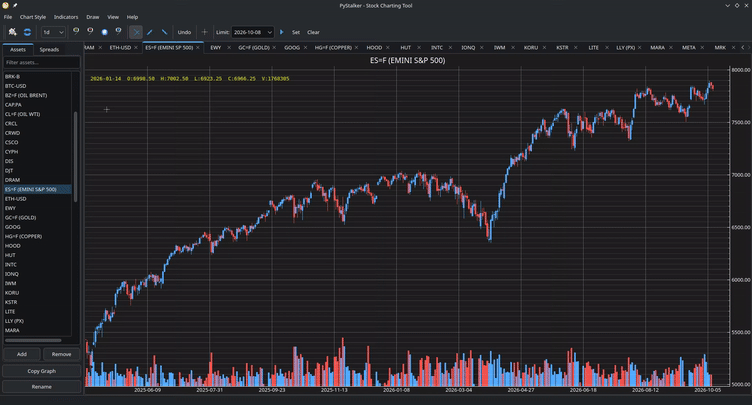

# pystalker
A trading analysis software, it is a port of the old and discontinued Qtstalker.




# Description of the project

Around 2005/2006 a trading analisys program was bundled with Debian Linux distributions, this was the time I discovered Qtstalker.

The program was very good and very advanced to its time, took a very good advantage of the LibQT3 and TA libraries and it can work with lots of external resources such Yahoo API, CSV data, CME data and NYBot data.

Around 2010 there was the begin of a new version that changed all the behaviour of the program, but never was released, I personally talked with the main developer Stefan Stratigakos about this new version, but some time later I discovered that the program was discontinued and the project abandoned.

I worked almost every day with qtstalker, I built some infrastructure of data ingestion in real time to feed qtstalker every minute and worked with trading graphics in almost real time, I reverse-engineered my own broker to get real-time data from futures, CFDs, commodities and Forex, my infrastructure is still alive and I made it fail-safe against every possible problem with receiving data, from a electric cut to a connection loss, my system is always feeding Qtstalker with data as far as possible.
 
I had a real time trading system made with my own hands shared with free open source software and I was very proud of it, at that time platforms like Trading View and many others famous platforms as well didn't exist.

This project is done with a wish of recover that project and make it open source software because I search for a new similar project and didn't find anything that can compare with Qtstalker and I want to make some improvements I had in mind at the time I was using Qtstalker.

I only have a very basic knowledge of C++ and LibQT, I am mainly a python developer, so with AI and agentic development I tried to recover this project with some stages:

1.- I tried to compile Qtstalker inside a very old Debian distribution in docker, get the binary in my current and modern Ubuntu system, and copied all the old LibQT3 libraries in my system, good but not satisfactory at all.
2.- I tried to port the original Qtstalker program from LibQT3 to LibQT5 using OpenCode, Ollama and GLM-5 model, got some good results but not satisfactory at all.
3.- Then I tried to program a C++ LibQT5/6 port from scratch telling AI to make the same program as the qtstalker original code, still not satisfactory.
4.- My final try was to make a python program with PyQT6 to emulate the same behaviour of the original program, and providing the AI agent with the original code, it seems that this time the result was good.

When I wrote this README first time, the project is still in a very early stage, has lots of bugs, many functions are not working and there is a long trip to get the program finished and in the stage of what I would consider finished, but I want to share the code with the communinty and see if there are people interested on the project and able to contribute to it, in the current state it is really usable and can deliver results.

Now the project is a MVP, can get daily data and I added some new improvements like spreads, ML indicators for prediction and the automatic channel detection.


# Features

- Downaloads data from Yahoo Finance (only daily data), from the Phemex exchange (crypto spot and perp futures, tokenized stocks/ETFs and TradFi perp futures, only daily data), from the Pionex exchange (crypto spot pairs and perpetual futures, with deep history) and imports CSV files, future support for possibly other data source endpoints, also in real time!
- Overlay technical indicators: Simple Moving Average, Exponential Moving Average, Bollinguer Bands, Parabollic SAR, SuperTrend (period 10, multiplier 1.8 by default - the project's parameters, editable per chart; its four lines use the project's colors - Up RGB(85,255,0), Down RGB(255,0,0), Upper RGB(85,255,127), Lower RGB(255,85,127) - and the Up/Down trend lines come hidden by default, the Upper/Lower band lines visible; the per-line "Visible" checkboxes of the Add/Edit Indicator dialogs re-enable them).
- Stacked technical indicators: MACD, RSI, CCI, ADX, ATR, Momentum, ROC, Stochastic, Stochastic RSI, WILLR, OBV, MFI.
- Drawings: Trendlines, Horizontal lines, Vertical lines, Ascending and Descending Channels (drawn manually or detected automatically), future support for fibonacci drawings.
- Types of graphs: Lines, candles, Heikin Ashi, future support for open candles.
- Tools: pystalker_cli.py, the unified command-line program - ONE program with every tool INSIDE it (the user's request: the code is not dispersed - the console programs are integrated, not restored): `operations` (the trading journal), `update` (update all assets' data, the File > Update All Stock Data twin), `scanner` (the fused scanner: `--channels` for the drawn channels, `--supertrend` for the supertrend indicator, `--all` or bare for both at once, `--date` for a past day's scan, `--near`/`--broken`/`--open-broken` for one section of the listing alone, `--historical` with `--asset` for one asset's whole event history), `status` (the per-asset snapshot: the last close with its daily and weekly changes, the last update date, the channel and the supertrend distances and breaks) and `list phemex` / `list pionex` (the exchange product listings). Every command keeps the flags of its original program; the machine-learning programs (the volatility prediction, the flip failure study and the supertrend trade suite) remain their own files in console_programs/, as does the correlation study (below).
- Volatility prediction (console_programs/volatility_prediction.py): a standalone machine-learning experiment, independent of the rest of the project for now. It reads the database and predicts, per asset, the next day's percent volatility and the probability of a high-volatility day (above the asset's own median) with a pluggable ML algorithm (LightGBM by default, `--model sklearn` to swap). Default mode predicts the day after the last bar of every asset and records each prediction in the `volatility_predictions` journal, so its result - the signed weekly percentage of its predicted day's Friday-close week - can be checked over the following week: the prediction table shows a VERIFIED / AVG WEEK % summary per asset, `--results` shows the journal against its outcomes (per-prediction with `--asset`, per-asset averages otherwise), and `--weekly` lists the weekly percentage of all the assets for all their history (`--no-store` skips recording; `--final-date` runs the split-at-date historical backtest). `--half-life YEARS` applies a recency weighting to the training (each day's weight halves every YEARS of age over the full history; default 0 = uniform weights, which measured slightly better on both out-of-sample windows tried). The listing's last fields read the stored history, all computed by the batch companion `volatility_accuracy.py`: **MATCH %** is the predictor's historical weekly accuracy per asset (it walks every week of the stored history, makes the prediction as of each week's end with only the data known by then - yearly walk-forward retraining - and counts the weeks whose high/low call matched the real outcome; the week-by-week rows are stored and browsable with `--weeks`), and **AVG DAY %** / **DAY MATCH %** are the daily mirror (`--daily` walks every day, storing one row per day - browsable with `--days` - and the average realized daily volatility plus the day-call accuracy per asset). The listings show the assets' personalized display names; `--asset` accepts the official symbol, the display name, or an unambiguous part of either.
- Supertrend flip failure study (console_programs/supertrend_flip_study.py): a standalone machine-learning study, sibling of the volatility programs. Every flip of every asset (the close crossing the ACTIVE line - the classic signal) becomes a trade - the entry at the flip day's close with the new trend (long on a flip Up, short on a flip Down) - and its outcome is measured: WIN when the stop (1.5x the PREDICTED volatility, the volatility program's honest walked predictions stored in `volatility_accuracy_days`; the still-open flips use the live volatility model) is never hit within `--days` (default 7) bars AND the close `--days` bars later is in profit, FAIL otherwise (stopped out even if it recovers, or day 7 losing). A LightGBM classifier learns the failures from everything known at the flip - the supertrend context (the side, the ended trend's age, the beyond %, the distances to both channel lines, the line's slope), the predicted volatility and its probability, the averages (SMA 5/20/50, EMA 10/50, the SMA20/50 cross), RSI(14), MACD, ATR(14) and its ratio, the Bollinger position and width, the momentum, the realized volatility, the volume z-score and the day of the week. The 80/20 CHRONOLOGICAL check (the earlier 80% of the labeled flips trains, the latest 20% is checked: accuracy, ROC AUC, precision/recall of the failures, the confusion matrix, vs the naive majority baseline), then the final model trains on ALL the labeled flips and predicts the STILL-OPEN ones (the last `--days` bars): the failure probability, the entry and the stop of every flip whose outcome is not known yet. `--asset`, `--period`, `--multiplier`, `--days`, `--stop-mult`, `--model` (lightgbm/sklearn) and `--no-color`; the database is only read (mode=ro). Measured on the live database: 26,110 labeled flips, **66.07 % failed** (the base failure rate - the study's headline), the 20% check scored accuracy 66.68 % vs the 65.72 % naive baseline with ROC AUC 0.57 (a weak but real edge - the failure is mostly the base rate), the top features led by the predicted volatility, and 82 still-open flips predicted (the most likely failures first).
- Supertrend flip trade suite (console_programs/supertrend/): three programs sharing a YAML trade definition and one LightGBM model PER ASSET. **config.yaml** defines the trade: the success window (`days`), the stop (`stop_times` - a decimal like 1.5 or 1.75 - times the PREDICTED daily volatility of the volatility_prediction program), the direction (`same` = with the new trend, `opposite` = against it), the supertrend's period/multiplier, the ML algorithm and the feature switches - moving averages, RSI and/or Stochastic (periods, 0 disables), MACD, ATR, Bollinger, momentum, volume. **train.py** trains (or retrains) an asset's model on ALL its history's flips, each a trade per the config with three outcome classes - WIN (never stopped AND the day-N close in profit), STOP (the stop touched within the window), LOSS (never stopped, day-N losing; P FAIL = STOP + LOSS) - storing `models/SYMBOL.joblib` with the config snapshot; assets with fewer than 40 labeled flips or a single outcome class are skipped with their counts. **predict.py** reads a NEW flip case (the asset's latest flip, or `--date` for a specific one) and prints P SUCCESS / P STOP / P DAY-N LOSS with the trade's recap; a warning shows when the current config.yaml drifted from the model's training snapshot (the snapshot always wins). **backtest.py** evaluates a PAST operation (`--asset` + the flip day): the model's probabilities AND the flip's real outcome side by side (the stop-touch day, or the day-N close vs the entry), marking flips that were part of the training data as in-sample (optimistic) and recomputing every outcome from the bars. The stop's volatility comes from the volatility program's honest walked predictions (`volatility_accuracy_days`), the live model for the recent days, `'-'` when the asset is too young for one; the database is only read (mode=ro). Measured live: TSLA's model trains on 257 flips (79 WIN / 168 STOP / 10 LOSS) and gives its 2026-11-11 long flip P STOP 95.5 %.
- Next week recommendation (console_programs/next_week_recommendation.py): the best ASSET for the next week, from the five rules of the 2026 strategy report (docs/all_2026_best_performing.md) - standalone, plain sqlite3 and numpy, the database read-only (mode=ro). The candidate pool is THE EXPLOSION ZONE (the assets that moved >= `--min-move`, default 10%, in the last completed week - the report measured 26/48 weekly winners coming from exactly that), every candidate's VEHICLE is identified from the bars (the 90-day daily-returns regression vs SOXX and SPY: a 3x semis bull or inverse - the negative correlation included -, a high-beta single, a plain asset; the volatility family labeled what it is), the FUEL is the volatility predictor's stored call for the next trading day (the journal volatility_predictions on a live run - run volatility_prediction.py first -, the honest as-of walk volatility_accuracy_days with `--date`), and the score = the vehicle 0-10 + the explosion 0-10 + the fuel 0-10 + the cluster 0-5 (the 2026 clusters: semis/AI that won 65% of the weeks first). The direction is NOT forecast - the report's honest split (13 momentum continuations vs 13 snapbacks from the exact same setup, the regime label persisting only 43% of weeks) - so the #1 recommendation prints BOTH trade setups (the long and the short entry, each with its 2x-predicted-volatility stop and the position size that makes it survivable), and the fuel column carries its source ([w]alk / [j]ournal). Validated live against all 48 report winners with `--date`: the pool catches 25/48 (52% vs a ~0.6% base rate of naming the weekly winner among 157 assets), the top-10 of the score 12/48 - the pool is the edge, the ranking the honest weak part (the never-walked SNXX family and the pre-journal weeks have no fuel to rank on).
- Volatility stop (console_programs/volatility_stop.py): the best stop loss level for any asset bought or sold with the weekly strategy - standalone, read-only. The stop is K times the PREDICTED daily volatility (the journal's latest call, the as-of walk with `--date`, the realized 20-day standard deviation as the flagged fallback), and K=2 (`--stop-times` overrides) is THE MEASURED BEST: the calibration ran the 48 weekly winners of 2026 and their maximum adverse excursion within the winning week - a median of only 0.47x the predicted daily vol (12 of 48 never went against the entry at all), so 2x lets 85% of the winners run while 1.5x would have stopped 27% of them and 3x only saves 3 more; 2x the daily sigma is also 0.9x the WEEKLY sigma (sigma_day x sqrt(5)), about one weekly standard deviation for a 5-day hold. The program prints the whole ladder (1x/1.5x/2x/3x sigma_day, 1x and 2x sigma_week) with the prices on the chosen side (`--direction`), THE recommended level, and THE POSITION that makes it survivable (`--risk` percent of the account -> the position fraction; a 3x vehicle needs the smallness). `--asset` accepts the symbol or a substring of its display name, an exact match beating the substrings.
- Asset-index correlation (console_programs/correlation.py): a standalone program by explicit choice - no links to any other program, plain sqlite3 and numpy on the database file, zero pystalker imports (the display names are read straight from the settings tables), the connection read-only (mode=ro). For every asset in the database except the indexes themselves, the Pearson correlation of its history against each of the seven market indexes - the S&P 500 family (ES=F, SPY, SPYXUSDT) and the Nasdaq 100 family (NQ=F, QQQ, NAS100USDT, QQQUSDT), Yahoo and Phemex - in TWO tables on the two bases: DAILY % RETURNS (how each day's percent change matches the index's same-day percent change, the way correlation is usually meant) and CLOSE PRICE LEVELS (the long-run travel together of the raw closes). One row per asset, one column per index PLUS THE FINAL AVERAGE column - the mean of the row's available correlations (the cells showing '-' do not count, so the young USDT perps average their three Phemex columns; a row without a single correlation shows '-' there too) - the columns headed by the indexes' personalized display names (the symbols when they have none), the rows showing their display names like every pystalker listing, sorted by the AVERAGE (the highest first, the inverse movers at the bottom of the correlated ones, the rows without an average last), with `--sort-by INDEX` switching the sort to one index's column instead, `--days N` (each pair limited to its last N shared bars), `--min-shared` (default 60 shared bars to report a correlation; '-' below that, and '-' for a flat series), `--asset` (a substring of the symbol or the display name) and `--no-color`. The correlation of a pair is computed over the bars both share - an asset and an index usually start at very different times. Measured live: the 150 assets in ~2 seconds - SOXL tops the average (+0.80 returns, the closest follower of ALL the indexes), SOXSUSDT (the inverse semiconductor ETF) bottoms at -0.87, and the young USDT perps join the ranking by averaging their available Phemex columns.
- Trading journal: Operations (Trading -> Operations) to annotate and list trading operations (bots, spots/futures, paper trading, planned projects that may or may not start) with their volume, stop price, current price, the net gain % (the 1x move, without leverage), the leveraged gain % and the final gain % (the leveraged gain at the exit price); the list is grouped in three tabs - Open (running, not planned), Planned (all the planned projects) and Closed (done, not planned), with the counts on the tabs; planned operations keep the plain gain look (no green/red) until they really start; each operation draws its entry line (bright green for longs, bright red for shorts) and its exit line (bright blue) on the asset's chart, plus its stop line - light red, RGB(255,85,127) - when it has a stop price (an empty stop draws no line). The same journal is listed from the terminal with `python pystalker_cli.py operations` - the same columns and numbers, split into the same three titled sections (or one alone with `--open`/`--planned`/`--closed`), ANSI green/red colors (planned operations stay plain) and filters (`--asset`, `--paper`).
- Assets have an official ticker for the data provider and a personalized display name (lower case allowed) shown in the ticker list, chart tabs, Operations and the spread creator's asset pickers, so renamed assets keep updating from the right source.
- Asset Overlap (File -> Asset Overlap...): overlap two or more assets - a minimum of two, with no limit on how many more you add - by their PERCENT CHANGE along the days, to compare how they move just by viewing: every asset draws one line starting at 0% - each day's increase or decrease against the first shared close of its own asset - in the same chart, each line in its own color with the asset's name as its colored legend, and NO Diff line at any asset count, two included (the user's final word: it "does not show real information"; the spreads keep theirs); the crosshair reads every asset's percent at the hovered day. The dialog lists the assets by their personalized display names (the first two pre-chosen, like the spread creator), the start date is either the first data date (the first day all the chosen assets share, the default) or a chosen date, and the overlap is auto-named by joining its symbols with `/` (AAPL/MSFT/TSLA). The overlaps live in the navigator's Overlaps tab next to Assets and Spreads - a double-click opens the chart, Remove deletes it - and survive restarts like spreads (their lines persist as saved bars); the chart's right-click menu changes each line's color, re-picks the assets (Change Assets...: the same dynamic list as the creator, pre-filled with the current ones - the auto-name follows the new assets, so the entry is renamed, and the assets that stay keep their line colors while the new ones take the next free palette colors), and changes the start date; the changed colors persist too.


# Automatic channel detection

The automatic channel is one of the improvements I had in mind since my Qtstalker times: with one click (Draw -> Automatic Channel) the program analyses the last year of the asset and draws an ascending or descending channel over the trend, with a quality close to what you would get by drawing it by hand.



How it works:

- It analyses the last 12 complete months of data, excluding the current (partial) month.
- The channel always tries to **start on the window's absolute minimum (ascending channel) or maximum (descending channel)** - the year's lowest low / highest high anchor the base line first, tried on both the standard window and the one including the current month (when the current rally has broken the standard-window extreme channel, the extended one - which contains the newest prices - is the one drawn); only when no valid channel can be built from them does it fall back to the year-start swing and then to the other confirmed swing points.
- A channel is only valid when its lines are respected **from its anchor on** - the lines are drawn from the anchor bar to the right, so that is exactly the range it must contain: the base line may be touched by later lows but never pierced (pokes up to 1% of the year's price range count as touches), and the parallel line goes through the year's extreme from the anchor, so nothing crosses it. The supports are tried in cleanliness order until one produces a valid channel.
- The channel is only drawn if the current price respects it: if any recent close has gone beyond one of the channel lines the candidate is invalidated and the program recalculates with the next candidate before drawing anything. For very strong trends where every candidate is broken it retries once including the current month, so the channel contains the newest prices.
- When the last year admits no clean channel at all (e.g. an accelerating trend piercing every base line), the **best-effort channel** - the first candidate in priority order whose base line is pierced by at most 15% of the year's price range and that the current price has not broken - is drawn as a last resort: the closest to what you would draw by hand when some wicks must stay outside. Only when even that is impossible (nothing is drawn).
- Once drawn, the result is a normal channel drawing: it is never recalculated or moved again, and you can edit it, copy it, recolor it or delete it exactly like any manually drawn channel.

To be honest, the detection is not perfect, but it is near perfect: markets are messy and occasionally it can miss a structure that your trader eye will see better. For those cases you can always draw the channel manually, the automatic channel is only one more tool in the toolbox.



Full quality video: [automatic_channel.mp4](automatic_channel.mp4)

<!-- Note: GitHub does not render <video> players for files committed in the
     repository. If you prefer a real video player instead of the animated GIF:
     open this file in the GitHub web editor and drag & drop automatic_channel.mp4
     at this spot - GitHub will upload it and insert a working inline player. -->


# Discovering assets near the channel limits

The channels become much more useful when you can watch them all at once. The channel scanner (the fused `python pystalker_cli.py scanner --channels`) is an independent tool that scans every asset in the pystalker database, discards the ones without drawn channels, and reports which assets have their price near a channel line - by default inside the channel and within 10% of the lower or upper line - showing the asset (its personalized display name, like Operations, falling back to the official symbol when it has none), whether the channel is ascending or descending, which line the price is near, and the proximity percentage. It also notifies you when the current price has broken a channel, so you know that channel is invalidated and you can draw a new one. The CHANNEL column shows Ascending in green and Descending in red letters, and the NEAR LINE column shows Upper in green and Lower in red; the broken-channels notifications use the same color coding (Ascending channel in green, Descending channel in red, "beyond the upper line" in green, "beyond the lower line" in red). `--no-color` prints plain text, and with `--lower-than <price>` the whole report keeps only the assets whose last price is at that price or lower (e.g. `--lower-than 15`); the application's Channel Scanner dialog (Trading > Channel Scanner) has the same filter as its "Lower than" input box, and its CHANNEL / NEAR LINE columns and the "beyond upper/lower line" sentences use the same color coding as backgrounds (white letters on green/red, the Operations-list look); the two sections are separated by a draggable border (the near table keeps about 3x the broken section's height), double-clicking a row opens the asset's chart with draggable indicator lines at the channel's line values (upper in green, lower in red), and clicking a column header sorts the tables like the Operations list (the numeric columns sort numerically).

```
python pystalker_cli.py scanner --channels
python pystalker_cli.py scanner --channels --max-proximity 5
python pystalker_cli.py scanner --channels --asset BTC-USD
python pystalker_cli.py scanner --channels --lower-than 15    # only assets at $15 or lower
```

The Supertrend scanner (the fused `python pystalker_cli.py scanner --supertrend`) is its sibling: it computes the classic Supertrend indicator (ATR period 10, multiplier 1.8 - changeable with `--period` and `--multiplier`) over each asset's daily bars and reports the last close against the ACTIVE trend line - the lower support in an Up trend, the upper resistance in a Down trend. The TOUCHING table lists the assets whose close is within (by default) 10% of the line, with the trend (Up in green, Down in red), the line, the trend age in bars, the proximity and the values; the SURPASSED notifications report the assets whose close crossed the line on the last bar - in the classic Supertrend the trend flips exactly then ("the Down trend flipped Up - the close X surpassed the upper line (Y) by Z%", green for the upper line, red for the lower one). The OPEN BROKEN SUPERTREND CHANNEL alerts report the assets whose last bar OPENED outside the Supertrend channel - beyond the Upper or the Lower line, whatever the candle's direction. The channel is the one the chart's supertrend indicator draws: the ACTIVE ratcheted line (the Lower support in an Up trend, the Upper resistance in a Down one) plus the freshly recomputed basic line (hl2 +- multiplier * ATR) on the other side - NOT the stale ratcheted band, so an open the chart shows inside the channel never fires. The notification reads "the open X broke the Upper/Lower line (Y) by Z% - a Up/Down candle, close W", with the line and the candle in the established colors (Upper/Up green, Lower/Down red); the open can break while the close does not, and the other way around. The alert section closes the scanner listing - it does not fire often, so the bottom of the output is where it is easiest to locate (after the by-asset view in --all mode; nothing is printed when no asset fired). The application's Supertrend dialog (Trading > Supertrend) mirrors the channel scanner's look: the supertrend indicator's palette as backgrounds (Up RGB(85,255,0), Down RGB(255,0,0), Upper RGB(85,255,127), Lower RGB(255,85,127)) with black bold letters, the period/multiplier/max-proximity controls, a draggable border between the sections (the touching table keeps about 3x the surpassed section's height), column sorting like the Operations list, and double-clicking a row opens the asset's chart with a draggable indicator line at the reported level colored BY THE TREND (the indicator's Up color in an Up trend, its Down color - red - in a Down one: the trend is the supertrend's signal); the next double-click replaces the previous line.

Both scans live in ONE command too: the `scanner` command of pystalker_cli.py fuses them - `--channels` for the channel scan alone, `--supertrend` for the supertrend scan alone, and `--all` (or a bare `scanner`) for both reports one after the other, with `--max-proximity`, `--asset` and `--date` applying to both and the scan-specific flags keeping their meanings. `--date YYYY-MM-DD` scans a PAST day: only the bars up to that date, so the channels (the drawings are anchored at bar positions), the supertrend bands and all the events - including that day's flips, touches and open breaks - are evaluated at that moment of the history; the header notes the as-of date. After the two reports, the `--all` mode appends the both-scans-by-asset view: one row per asset with its channel condition and its supertrend condition side by side ('-' when the asset has only one of them), sorted by the assets' display names, in two tables - NEAR A CHANNEL LINE / TOUCHING THE SUPERTREND LINE (with the trend age and the last close) and BROKEN CHANNEL / SUPERTREND FLIP, each title carrying its day like every other section's title - each closed by the count of assets with both conditions, only the channel's and only the supertrend's, so it is easy to see which assets have both conditions and which only one; the broken/flip summary then breaks its events down: the broken channels by the line they broke and the flips by their direction, each count with its percentage of that event type's total (e.g. "Broken channels: 4 - 3 Upper (75.00%), 1 Lower (25.00%)"), counting the rows the table lists; an asset with several channel drawings shows its nearest (or closest broken) one, and the same color coding as the reports is used. The OPEN BROKEN SUPERTREND CHANNEL alert closes the listing when it fires. The section flags `--near`, `--broken` and `--open-broken` print ONLY that section of the listing - the near/touching table, the broken channel/supertrend flip table or the OPEN BROKEN alert respectively - handy to check just one condition: they can be combined (the chosen sections print in the listing's order), they take precedence over `--channels`/`--supertrend`/`--all` and run the scans their sections need (both scans for the by-asset tables, the supertrend scan for the alert), every other flag keeps applying, and an empty section prints its "No ..." line so a section-only run always shows the scan ran (the full listing keeps its established silence when the alert does not fire). The `--historical` flag (it needs `--asset`) scans ONE asset's WHOLE HISTORY instead of its last bar: every occurrence of a broken channel, a supertrend flip or an open broken supertrend channel, in one chronological list - each row is the event's date plus the established notification wording, closed by the counts (e.g. TSLA: 265 supertrend flips and 41 open broken events since 2010). One occurrence per EPISODE: the first bar of each stretch of bars outside a line (a price or an open can stay beyond for many days - that is one event, at the bar it started). `--historical --broken` shows only the broken channel + supertrend flip occurrences, `--historical --open-broken` only the open broken ones, `--near` is ignored (touching is a state, not an event), `--date` limits the history to that day, and `--period`/`--multiplier` set the supertrend parameters. Every scan lives inside pystalker_cli.py (the integrated program).

The `status` command (`python pystalker_cli.py status`) is the per-asset snapshot: one row per asset, sorted by its display name, with the last close colored by its daily move (green when it went up since the previous bar, red when it went down, plain when it did not move), the DAY % column (the percent change along the day) and the WEEK % column next to it (the percent change along the last week, vs the last close at least 7 days older; '-' when the history is shorter), both colored the same way, the last update date (when the shown data was last refreshed - the source asset's date for copies, '-' when never updated), the nearest drawn channel - its kind (Ascending in green, Descending in red) plus the percentage distances to the channel's upper and lower lines and the CH BREAK column (the line the close went beyond: Upper in green or Lower in red, '-' while inside) - and the supertrend bands: the percentage distances to the Up line (the support below the price, green) and the Down line (the resistance above, red) plus the ST BREAK column (the band the close went beyond, same coding). '-' marks what does not apply (no channel, or too few bars for the supertrend's warm-up), assets without bars go to the Skipped note, `--asset` shows a single asset, and `--period`/`--multiplier` set the supertrend's parameters (10 / 1.8 by default). With `--date YYYY-MM-DD` the whole status is shown AS OF that past date: only the bars up to it, so the close, the daily and weekly changes, the channel lines (the drawings are anchored at bar positions) and the supertrend bands are all evaluated at that moment of the history - the header notes the as-of date, and assets without data that early go to the Skipped note. With `--history` (it needs `--asset`) the asset's WHOLE DAILY HISTORY is shown: one row per bar since the begin, the oldest day first, each row with exactly the same columns as the status of that day - the close colored by its daily move, DAY %, WEEK %, the row's own day in the LAST UPDATE column (so each row identifies itself), the channel evaluated at that bar and the supertrend of that day ('-' while in the warm-up); `--date` ends the history at that day, and the count line shows the span (KBWB: "3778 day(s) - from 2011-11-01 to 2026-11-10"). The supertrend runs once over the whole history - its computation is causal, so each row shows exactly what a `--date` scan of that day would show.

```
python pystalker_cli.py scanner                    (channels + supertrend)
python pystalker_cli.py scanner --supertrend --max-proximity 5 --asset BTC-USD
python pystalker_cli.py scanner --supertrend --period 10 --multiplier 3
python pystalker_cli.py scanner --all
python pystalker_cli.py scanner --broken               (only that section alone)
python pystalker_cli.py scanner --near --open-broken  (two sections alone)
python pystalker_cli.py scanner --historical --asset TSLA      (TSLA's whole history)
python pystalker_cli.py scanner --historical --asset TSLA --open-broken
python pystalker_cli.py status --asset BTC-USD --history        (the whole history)
```

Example output (report date and time are always printed first, trimmed here):

```
Report generated: 2026-10-11 20:35:12 CEST
Channel scanner - assets with price within 10% of a channel line
Scanned 72 asset(s) with channel drawings

ASSET                CHANNEL     NEAR LINE  PROXIMITY    LAST CLOSE    LINE VALUE
^TNX (10Y US BOND)   Ascending   Upper          0.92%          5.32          5.37
SPY                  Ascending   Lower          1.72%        778.57        765.42
AAPL                 Ascending   Upper          2.90%        336.64        346.68
QQQ                  Ascending   Lower          4.30%        751.27        720.32
BTC-USD              Ascending   Upper          7.17%      82952.51      89362.74
AMD                  Ascending   Upper          7.66%        608.10        658.55
...
```


# Data sources

Daily candles come from three download sources, and you don't have to think about which one to use:

- **Yahoo Finance** for stocks, indices, bonds, forex and the big crypto pairs.
- **Phemex** (public API, no account needed) for everything Yahoo can't serve: the USDT/USDC perp futures (BTCUSDT, ETHUSDT...), the TradFi perp futures on tokenized stocks/indices/commodities (TSLAUSDT, NAS100USDT, XAUUSDT - gold...), the spot tokenized stocks (TSLA, AAPL, NVDA... traded against USDT around the clock) and the long tail of crypto pairs.
- **Pionex** (public API, no account needed) for its spot pairs (`BTC_USDT`, including the xStocks tokenized stocks `AAPLX_USDT`, `TSLAX_USDT`, `SPYX_USDT`...) and its perpetual futures (`BTC_USDT_PERP`), with deeper history: the kline endpoint pages back up to 10,000 daily candles (BTC_USDT reaches back to 2017).

You type the symbol in the normal Download flow and the program tries Yahoo Finance first; if Yahoo has nothing for that symbol it falls back to Phemex and then to Pionex automatically, so Phemex-only symbols like `sTSLAONUSDT` or `sBTCUSDT` and Pionex-only symbols like `BTC_USDT` or `BTC_USDT_PERP` simply download. Each asset remembers which source served it, so **Update All Stock Data** keeps fetching every asset from its right source. Phemex serves up to the last 1000 daily candles (around 2.7 years), more than enough for the automatic channel (1 year) and the S-R and scanner tools.

Since the Phemex symbol names are technical (the `s` prefix is their spot convention, `sTSLAONUSDT` is TSLAON/USDT), **File -> Download Phemex Symbol...** opens a searchable list of every listed Phemex product (spot pairs, crypto perp futures and TradFi/tokenized perps - search "Tesla", "gold", "BTC"... by asset name and double-click to download).

From the console, `python pystalker_cli.py list phemex` lists the Phemex assets with the exact symbols the Download flow accepts. By default it shows the **perp futures and the tokenized assets**: the crypto perp futures (BTCUSDT, BTCUSD...), the TradFi perp futures on tokenized stocks/indices/commodities (TSLAUSDT, NAS100USDT, XAUUSDT, SPACEXUSDT, OPENAIUSDT...) and the spot tokenized assets (the Ondo tokenized stocks and ETFs: Tesla, Apple, NVIDIA, Microsoft, SPY, QQQ, gold and silver trusts..., plus the xStocks series like SpaceX):

```
python pystalker_cli.py list phemex
python pystalker_cli.py list phemex --search Tesla
python pystalker_cli.py list phemex --type tradfi     # only the tokenized asset perps
python pystalker_cli.py list phemex --type crypto      # the normal crypto spot pairs
python pystalker_cli.py list phemex --type all
```

For Pionex, `python pystalker_cli.py list pionex` lists all its products (940: the spot pairs and the perpetual futures, with a NAME column for the perpetuals) with the exact symbols the Download flow accepts:

```
python pystalker_cli.py list pionex
python pystalker_cli.py list pionex --search BTC
python pystalker_cli.py list pionex --type spot        # only the spot pairs
python pystalker_cli.py list pionex --type perp         # only the perpetual futures
python pystalker_cli.py list pionex --all               # include the disabled products
```


# Running the program

Some parts of this project are C++ (from PyQT6) to improve speed to avoid the python slowing but you don't need to compile anything, I recommend to install PyQT6 libraries (if you still don't have on your Linux system) and create a virtual environment and run the program:

```
virtualenv venv
source venv/bin/activate
pip install -r requirements.txt
./pystalker_run.py
```

Or you can simply run directly without a virtual envinronment (not recommended):

```
pip install -r requirements.txt
./pystalker_run.py
```

I hope you like and enjoy this project, I promise to extend and maintain it.


# Configuration

This program will create a directory .pystalker in your home directory and it will create a little SQLite3 database to store the program configuration and the prices database.


Regards

Juan Luis Martínez

