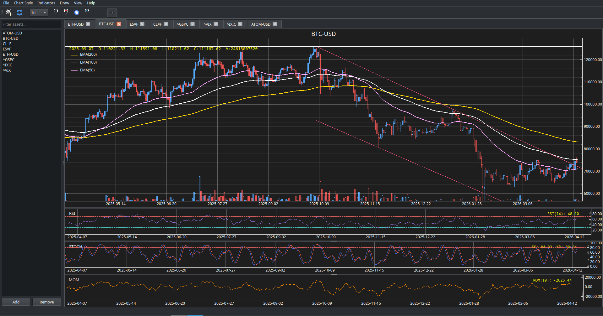
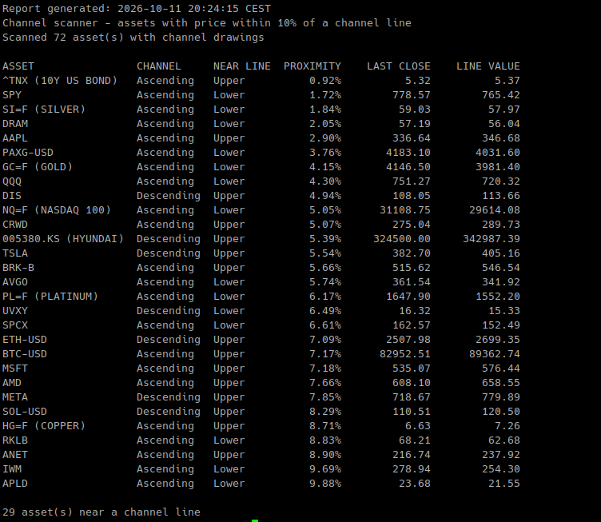

# pystalker
A trading analysis software, it is a port of the old and discontinued Qtstalker.




# Description of the project

Around 2005/2006 a trading analisys program was bundled with Debian Linux distributions, this was the time I discovered Qtstalker.

The program was very good and very advanced to its time, took a very good advantage of the LibQT3 and TA libraries and it can work with lots of external resources such Yahoo API, CSV data, CME data and NYBot data.

Around 2010 there was the begin of a new version that changed all the behaviour of the program, but never was released, I personally talked with the main developer Stefan Stratigakos about this new version, but some time later I discovered that the program was discontinued and the project abandoned.

I worked almost every day with qtstalker, I built some infrastructure of data ingestion in real time to feed qtstalker every minute and worked with trading graphics in almost real time, I reverse-engineered my own broker to get real-time data from futures, CFDs, commodities and Forex, my infrastructure is still alive and I made it fail-safe against every possible problem with receiving data, from a electric cut to a connection loss, my system is always feeding Qtstalker with data as far as possible.
 
I had a real time trading system made with my own hands shared with free open source software and I was very proud of it, at that time platforms like Trading View and many others famous platforms as well didn't exist.

This project is done with a wish of recover that project and make it open source software because I search for a new similar project and didn't find anything that can compare with Qtstalker and I want to make some improvements I had in mind at the time I was using Qtstalker.

I only have a very basic knowledge of C++ and LibQT, I am mainly a python developer, so with AI and agentic development I tried to recover this project with some stages:

1.- I tried to compile Qtstalker inside a very old Debian distribution in docker, get the binary in my current and modern Ubuntu system, and copied all the old LibQT3 libraries in my system, good but not satisfactory at all.
2.- I tried to port the original Qtstalker program from LibQT3 to LibQT5 using OpenCode, Ollama and GLM-5 model, got some good results but not satisfactory at all.
3.- Then I tried to program a C++ LibQT5/6 port from scratch telling AI to make the same program as the qtstalker original code, still not satisfactory.
4.- My final try was to make a python program with PyQT6 to emulate the same behaviour of the original program, and providing the AI agent with the original code, it seems that this time the result was good.

When I wrote this README first time, the project is still in a very early stage, has lots of bugs, many functions are not working and there is a long trip to get the program finished and in the stage of what I would consider finished, but I want to share the code with the communinty and see if there are people interested on the project and able to contribute to it, in the current state it is really usable and can deliver results.

Now the project is a MVP, can get daily data and I added some new improvements like spreads, ML indicators for prediction and the automatic channel detection.


# Features

- Downaloads data from Yahoo Finance (only daily data), future support for CSV data and possibly other data source endpoints, also in real time!
- Overlay technical indicators: Simple Moving Average, Exponential Moving Average, Bollinguer Bands, Parabollic SAR.
- Stacked technical indicators: MACD, RSI, CCI, ADX, ATR, Momentum, ROC, Stochastic, Stochastic RSI, WILLR, OBV, MFI.
- Drawings: Trendlines, Horizontal lines, Vertical lines, Ascending and Descending Channels (drawn manually or detected automatically), future support for fibonacci drawings.
- Types of graphs: Lines, candles, Heikin Ashi, future support for open candles.
- Tools: channel_scanner.py, to discover assets whose price is near a drawn channel line.


# Automatic channel detection

The automatic channel is one of the improvements I had in mind since my Qtstalker times: with one click (Draw -> Automatic Channel) the program analyses the last year of the asset and draws an ascending or descending channel over the trend, with a quality close to what you would get by drawing it by hand.



How it works:

- It analyses the last 12 complete months of data, excluding the current (partial) month.
- If the year started from a major high it draws a descending channel, if it started from a major low it draws an ascending channel; when the year-start structure is not valid it anchors on the year's lowest low or highest high, and then on the rest of the confirmed swing points.
- The channel is only drawn if the current price respects it: if any recent close has gone beyond one of the channel lines the candidate is invalidated and the program recalculates with the next candidate before drawing anything. For very strong trends where every candidate is broken it retries once including the current month, so the channel contains the newest prices.
- Once drawn, the result is a normal channel drawing: it is never recalculated or moved again, and you can edit it, copy it, recolor it or delete it exactly like any manually drawn channel.

To be honest, the detection is not perfect, but it is near perfect: markets are messy and occasionally it can miss a structure that your trader eye will see better. For those cases you can always draw the channel manually, the automatic channel is only one more tool in the toolbox.

You can watch a demonstration video here: [automatic_channel.webm](automatic_channel.webm)

<video src="automatic_channel.webm" controls muted width="752"></video>


# Discovering assets near the channel limits

The channels become much more useful when you can watch them all at once. `channel_scanner.py` is an independent tool that scans every asset in the pystalker database, discards the ones without drawn channels, and reports which assets have their price near a channel line - by default inside the channel and within 10% of the lower or upper line - showing the ticker, whether the channel is ascending or descending, which line the price is near, and the proximity percentage. It also notifies you when the current price has broken a channel, so you know that channel is invalidated and you can draw a new one.

```
python channel_scanner.py
python channel_scanner.py --max-proximity 5
python channel_scanner.py --symbol BTC-USD
```

Example output (report date and time are always printed first, trimmed here):

```
Report generated: 2026-10-11 20:35:12 CEST
Channel scanner - assets with price within 10% of a channel line
Scanned 72 asset(s) with channel drawings

ASSET                CHANNEL     NEAR LINE  PROXIMITY    LAST CLOSE    LINE VALUE
^TNX (10Y US BOND)   Ascending   Upper          0.92%          5.32          5.37
SPY                  Ascending   Lower          1.72%        778.57        765.42
AAPL                 Ascending   Upper          2.90%        336.64        346.68
QQQ                  Ascending   Lower          4.30%        751.27        720.32
BTC-USD              Ascending   Upper          7.17%      82952.51      89362.74
AMD                  Ascending   Upper          7.66%        608.10        658.55
...
```


# Running the program

Some parts of this project are C++ (from PyQT6) to improve speed to avoid the python slowing but you don't need to compile anything, I recommend to install PyQT6 libraries (if you still don't have on your Linux system) and create a virtual environment and run the program:

```
virtualenv venv
source venv/bin/activate
pip install -r requirements.txt
./pystalker_run.py
```

Or you can simply run directly without a virtual envinronment (not recommended):

```
pip install -r requirements.txt
./pystalker_run.py
```

I hope you like and enjoy this project, I promise to extend and maintain it.


# Configuration

This program will create a directory .pystalker in your home directory and it will create a little SQLite3 database to store the program configuration and the prices database.


Regards

Juan Luis Martínez

